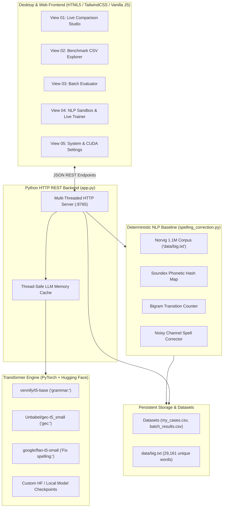

# LexiFix AI — Complete Technical Architecture & System Guide

Welcome to the comprehensive technical documentation for **LexiFix AI (Spelling Intelligence Studio)**. This document provides an in-depth, step-by-step explanation of how the platform works under the hood, detailing the mathematical algorithms, data pipelines, model bridges, and user interface workflows.

---

## Table of Contents
1. [Core Philosophy & Hybrid Design](#1-core-philosophy--hybrid-design)
2. [High-Level System Architecture](#2-high-level-system-architecture)
3. [End-to-End Data Flow](#3-end-to-end-data-flow)
4. [The Multi-Signal Deterministic NLP Engine](#4-the-multi-signal-deterministic-nlp-engine)
   - [4.1 Tokenization & Normalization](#41-tokenization--normalization)
   - [4.2 Peter Norvig Candidate Generation (`edits1` & `edits2`)](#42-peter-norvig-candidate-generation-edits1--edits2)
   - [4.3 American Soundex Phonetic Indexing](#43-american-soundex-phonetic-indexing)
   - [4.4 Damerau-Levenshtein Transposition Distance](#44-damerau-levenshtein-transposition-distance)
   - [4.5 Physical QWERTY Keyboard Geometry](#45-physical-qwerty-keyboard-geometry)
   - [4.6 Contextual Bigram Language Model](#46-contextual-bigram-language-model)
   - [4.7 Candidate Scoring & Decision Function](#47-candidate-scoring--decision-function)
   - [4.8 Dynamic Online Learning & Vocabulary Expansion](#48-dynamic-online-learning--vocabulary-expansion)
5. [Deep Learning Transformer Engine (PyTorch / Hugging Face)](#5-deep-learning-transformer-engine-pytorch--hugging-face)
   - [5.1 Model Zoo & Task Prefixes](#51-model-zoo--task-prefixes)
   - [5.2 Beam Search Generation](#52-beam-search-generation)
   - [5.3 Hardware Acceleration & CUDA Detection](#53-hardware-acceleration--cuda-detection)
6. [Comparative Evaluation & Metrics Engine](#6-comparative-evaluation--metrics-engine)
7. [Visual Diff & Token Alignment Engine](#7-visual-diff--token-alignment-engine)
8. [Client-Server & REST API Reference](#8-client-server--rest-api-reference)
9. [Desktop Window Architecture (`pywebview`)](#9-desktop-window-architecture-pywebview)
10. [Troubleshooting & Common Pitfalls](#10-troubleshooting--common-pitfalls)

---

## 1. Core Philosophy & Hybrid Design

Modern text correction typically falls into one of two extremes:
1. **Traditional Rule/Dictionary Checkers (e.g., Aspell, Hunspell):** Fast ($<2\text{ms}$) and lightweight, but oblivious to sentence context and phonetic nuances.
2. **Large Language Models & Transformers (e.g., T5, BART):** Contextually rich, but compute-heavy ($>1000\text{ms}$ on CPU), resource-intensive, and prone to hallucinations without strict prompt boundaries.

**LexiFix AI bridges this divide:**
* It delivers an **enhanced offline deterministic NLP baseline** operating at sub-millisecond speeds using a Bayesian Noisy Channel model, Norvig's 1.1M-token corpus, Soundex phonetic indexing, Damerau transposition distance, and bigrams.
* It embeds a **hardware-accelerated Transformer bridge** supporting state-of-the-art models (`vennify/t5-base-grammar-correction`, `Unbabel/gec-t5_small`, `google/flan-t5-small`, `oliverguhr/spelling-correction-english-base`).
* It couples them with an **explainability workbench** and **batch evaluation suite**, allowing researchers and developers to auditably measure latency, accuracy, Character Error Rate (CER), Word Error Rate (WER), and F1 scores side-by-side.

---

## 2. High-Level System Architecture

---

## 3. End-to-End Data Flow

When a user submits text (e.g., `"I recieve the mesage from my frend."`) into the Studio:

1. **Client Dispatch:** The browser/desktop frontend dispatches a `POST /api/correct` payload containing the input sentence, selected transformer models, and optional ground truth.
2. **Baseline Correction (`NoisyChannelSpellCorrector.correct`):**
   - The sentence is tokenized into word tokens and whitespace/punctuation delimiters.
   - Each token is looked up against the 29,000+ word vocabulary.
   - For unknown words (e.g., `recieve`, `mesage`, `frend`), candidate generation produces potential matches.
   - Candidates are ranked via multi-signal scoring (prior frequency, Soundex phonetic match, Damerau distance, QWERTY keyboard distance, and bigram context).
   - The original casing (lowercase, TitleCase, UPPERCASE) is restored.
   - The sentence is reconstructed preserving original whitespace and punctuation.
3. **Transformer Generation (`LLMCorrector.correct`):**
   - If selected, cached Transformer instances process the text.
   - The model-specific task prompt is prepended (e.g. `Fix spelling: ` for FLAN-T5, `grammar:` for T5-Base).
   - PyTorch runs Seq2Seq beam search (using CUDA GPU if available) to generate corrected text.
4. **Evaluation & Metrics:**
   - If ground truth is provided, both baseline and LLM outputs are scored against it (Word Accuracy, Token Precision, Recall, F1, Character Error Rate, Word Error Rate).
5. **Diff Visualization:**
   - The frontend receives the JSON response and computes a token-level visual diff, highlighting deletions (`rose`) and insertions (`amber`).

---

## 4. The Multi-Signal Deterministic NLP Engine

The offline baseline in [`spelling_correction.py`](file:///d:/Programming/LexiFix%20AI/spelling_correction.py) is grounded in Peter Norvig's Bayesian Noisy Channel formulation:

$$\hat{c} = \arg\max_{c \in C} P(c \mid w) = \arg\max_{c \in C} P(w \mid c) \cdot P(c)$$

Where:
* $P(c)$ is the **Language Model Probability** (how likely is candidate word $c$ in the English language).
* $P(w \mid c)$ is the **Error Model / Channel Probability** (how likely is a user to type word $w$ when intending to write $c$).

LexiFix AI expands this classical equation with multiple real-world typographical signals:

### 4.1 Tokenization & Normalization
The regular expression `r"[A-Za-z]+(?:'[A-Za-z]+)?"` extracts alphabetic words while retaining internal contractions (e.g., `don't`, `it's`). Punctuation and whitespace are preserved separately to guarantee lossless sentence reconstruction.

### 4.2 Peter Norvig Candidate Generation (`edits1` & `edits2`)
For any misspelled word $w$:
* `_edits1(w)`: Generates all strings at edit distance 1:
  - **Deletions:** Remove 1 character ($n$ variations)
  - **Transpositions:** Swap adjacent characters ($n-1$ variations)
  - **Substitutions:** Replace 1 character with any of 26 letters ($26n$ variations)
  - **Insertions:** Insert any of 26 letters at any position ($26(n+1)$ variations)
* `_edits2(w)`: Applies `_edits1` to every result of `_edits1(w)`, generating candidate strings at distance 2.
* Only candidates that exist in the active vocabulary are retained.

### 4.3 American Soundex Phonetic Indexing
Many typos are phonetic slips (e.g., `frend` for `friend`, `phish` for `fish`). 
The Soundex algorithm indexes words by auditory representation:
1. Retain the first letter capitalized.
2. Replace consonants with phonetic group numbers:
   - `B, F, P, V` $\rightarrow$ `1` (Labials)
   - `C, G, J, K, Q, S, X, Z` $\rightarrow$ `2` (Gutturals & Sibilants)
   - `D, T` $\rightarrow$ `3` (Dentals)
   - `L` $\rightarrow$ `4` (Liquid)
   - `M, N` $\rightarrow$ `5` (Nasals)
   - `R` $\rightarrow$ `6` (Liquid)
3. Ignore vowels and `H`, `W`, `Y`.
4. Collapse consecutive duplicate digits.
5. Pad with trailing zeroes to 4 characters (e.g. `F653`).

**Result:** `_soundex("frend") == _soundex("friend") == "F653"`. The model grants candidates matching the query's Soundex code a $+3.5$ score bonus!

### 4.4 Damerau-Levenshtein Transposition Distance
Standard Levenshtein considers adjacent transpositions (`ie` $\rightarrow$ `ei` in `recieve`) as **two operations** (1 delete + 1 insert, or 2 substitutions), giving $d=2$. 
Damerau-Levenshtein treats adjacent swaps as a **single transposition** ($d=1$):

$$D(i, j) = \min \begin{cases}
D(i-1, j) + 1 & \text{(Deletion)} \\
D(i, j-1) + 1 & \text{(Insertion)} \\
D(i-1, j-1) + \text{cost} & \text{(Substitution)} \\
D(i-2, j-2) + 1 & \text{if } left[i] == right[j-1] \land left[i-1] == right[j] \text{ (Transposition)}
\end{cases}$$

Candidates with transposition-only differences receive an effective distance of $1$, vaulting words like `receive` to the top of the candidate ranking.

### 4.5 Physical QWERTY Keyboard Geometry
When humans type on physical keyboards, slip-of-the-finger errors happen between physically adjacent keys (e.g., pressing `s` instead of `a` or `w`). 
LexiFix maps keys to Cartesian coordinates:

$$d_{\text{keyboard}} = \sqrt{(row_1 - row_2)^2 + (col_1 - col_2)^2}$$

Substitutions involving keys within $d_{\text{keyboard}} \le 1.5$ receive a physical proximity bonus.

### 4.6 Contextual Bigram Language Model
Single-word frequency cannot distinguish between homophones or context-sensitive words (e.g., `peace` vs `piece`). 
The engine maintains a transition counter for consecutive token pairs $(w_{i-1}, w_i)$ and $(w_i, w_{i+1})$. 
Candidates with established transitions receive logarithmic frequency bonuses:

$$\text{Bonus}_{\text{bigram}} = 3.5 \cdot \ln(1 + \text{Count}(w_{i-1}, c)) + 2.0 \cdot \ln(1 + \text{Count}(c, w_{i+1}))$$

### 4.7 Candidate Scoring & Decision Function
The aggregate multi-signal score for candidate $c$ given query $w$ is:

$$\text{Score}(c) = \ln(1 + \text{Freq}(c)) + \text{Bonus}_{\text{phonetic}} + \text{Bonus}_{\text{transposition}} + \text{Bonus}_{\text{bigram}} + \text{Bonus}_{\text{keyboard}}$$

Candidates are sorted deterministically:
1. **Primary Sort:** Effective Edit Distance (ascending, lower is better).
2. **Secondary Sort:** Multi-signal score (descending, higher is better).
3. **Tertiary Sort:** Lexicographical order (alphabetical tie-breaker).

### 4.8 Dynamic Online Learning & Vocabulary Expansion
LexiFix allows users to train the model live in the UI or via REST API (`POST /api/model/train`):
* New words are added to `self.vocabulary`.
* Unigram frequencies `self.frequencies` are incremented.
* Bigram transitions `self.bigrams` are registered.
* Soundex phonetic buckets `self._soundex_index` are instantly updated.
* No server restart or disk re-indexing is required.

---

## 5. Deep Learning Transformer Engine (PyTorch / Hugging Face)

LexiFix integrates Seq2Seq transformer models via [`LLMCorrector`](file:///d:/Programming/LexiFix%20AI/spelling_correction.py#L536):

### 5.1 Model Zoo & Task Prefixes
Different transformer models require specific input formatting:
| Model Identifier | Parameter Count | Architecture | Required Task Prefix | Purpose |
| :--- | :--- | :--- | :--- | :--- |
| `vennify/t5-base-grammar-correction` | 220M | T5-Base | `grammar:` | Primary high-accuracy GEC model |
| `Unbabel/gec-t5_small` | 60M | T5-Small | `gec:` | Ultra-fast lightweight GEC |
| `google/flan-t5-small` | 80M | FLAN-T5 | `Fix spelling:` | General instruction Seq2Seq |
| `oliverguhr/spelling-correction-english-base` | 140M | BART | *(None / `""`)* | Dedicated English spelling model |

### 5.2 Beam Search Generation
Rather than greedy decoding (which picks the single highest probability token at step $t$), LexiFix uses **Beam Search** with `num_beams=2`:
* It maintains the top 2 candidate hypotheses at each decoding step.
* This prevents local optima traps and yields grammatically fluent outputs.
* Sampling is disabled (`do_sample=False`) to ensure deterministic, reproducible results.

### 5.3 Hardware Acceleration & CUDA Detection
Upon initialization, `LLMCorrector` inspects `torch.cuda.is_available()`. If a CUDA-compatible NVIDIA GPU is present, weights are loaded directly to VRAM (`.to("cuda")`), achieving $5\times$ to $10\times$ faster inference than CPU execution.

---

## 6. Comparative Evaluation & Metrics Engine

When comparing model outputs against ground truth references, LexiFix AI computes a full suite of standardized NLP metrics:

1. **Positional Word Accuracy:**
   $$\text{Accuracy} = \frac{\sum_{i=1}^N \mathbb{I}(\text{pred}_i == \text{ref}_i)}{\max(\text{len}(\text{pred}), \text{len}(\text{ref}))}$$
2. **Character Error Rate (CER):**
   $$\text{CER} = \frac{\text{LevenshteinDistance}(\text{reference}, \text{prediction})}{\max(1, \text{len}(\text{reference}))}$$
3. **Word Error Rate (WER):**
   $$\text{WER} = \frac{\text{TokenLevenshteinDistance}(\text{ref\_tokens}, \text{pred\_tokens})}{\max(1, \text{len}(\text{ref\_tokens}))}$$
4. **Correction Precision, Recall, and F1:**
   - Evaluates only the tokens that required modification from the source input.
   - **True Positive (TP):** An error that was correctly altered to match reference.
   - **False Positive (FP):** An unnecessary modification made to an already-correct word.
   - **False Negative (FN):** An error that was left uncorrected.
   $$\text{Precision} = \frac{\text{TP}}{\text{TP} + \text{FP}}, \quad \text{Recall} = \frac{\text{TP}}{\text{TP} + \text{FN}}, \quad \text{F1} = 2 \cdot \frac{\text{Precision} \cdot \text{Recall}}{\text{Precision} + \text{Recall}}$$

---

## 7. Visual Diff & Token Alignment Engine

The studio visualizes differences using an aligned token-level diff engine in `web/app.js`:
* Deleted/erroneous tokens are rendered in **Eclipse Plum / Soft Rose** with dotted strike-through borders.
* Inserted/corrected tokens are rendered in **Amber Flare / Soft Amber** badges.
* Unchanged tokens remain clean, legible body text.
* Users can toggle between **Visual Diff**, **Clean Text**, and **Explainability Diagnostics** with a single click.

---

## 8. Client-Server & REST API Reference

The backend operates an asynchronous, multi-threaded HTTP REST server powered by `LexiFixRequestHandler` in [`app.py`](file:///d:/Programming/LexiFix%20AI/app.py):

| Method | Endpoint | Request Body | Response Description |
| :--- | :--- | :--- | :--- |
| `GET` | `/api/info` | None | Returns PyTorch version, CUDA status, and Python runtime info |
| `GET` | `/api/vocabulary` | None | Returns active vocabulary size, total token counts, and top words |
| `GET` | `/api/csv/list` | None | Lists available benchmark CSV files in workspace |
| `GET` | `/api/csv/read?file=...` | Query param: `file` | Reads CSV headers and rows for data tables |
| `POST` | `/api/correct` | `{"text": "...", "expected_text": "...", "models": [...]}` | Corrects text across baseline & LLMs with metrics |
| `POST` | `/api/explain/word` | `{"word": "..."}` | Returns candidate ranking breakdown, Soundex hash, and distances |
| `POST` | `/api/model/train` | `{"text": "..."}` | Ingests new text into the active model vocabulary |
| `POST` | `/api/benchmark/run` | `{"cases_file": "...", "output_file": "...", "models": [...]}` | Executes batch evaluation over dataset |
| `POST` | `/api/csv/save` | `{"filename": "...", "headers": [...], "rows": [...]}` | Saves modified dataset records to CSV |

---

## 9. Desktop Window Architecture (`pywebview`)

LexiFix AI is configured as a dual-mode application:
1. **Native Desktop Window:** If `pywebview` is installed, `app.py` boots a native desktop window (utilizing Microsoft Edge WebView2 on Windows) sized at $1360 \times 880$ pixels with modern frameless styling.
2. **Browser Fallback:** If `pywebview` is unavailable or if `--browser` is passed, it automatically opens the URL in the system's default browser.
3. **Headless Server:** Passing `--no-open` starts the server in background daemon mode for automated testing or remote deployment.

---

## 10. Troubleshooting & Common Pitfalls

1. **HF Model Identifier 401/404 Errors:**
   - *Cause:* Non-existent Hugging Face repository names (e.g. `vennify/t5-small-grammar-correction`).
   - *Fix:* Ensure model checkpoint names match public repositories on `huggingface.co/models`. Use `vennify/t5-base-grammar-correction` or `Unbabel/gec-t5_small`.
2. **FLAN-T5 Generating Nonsensical Text ("I'm a snooty snoot."):**
   - *Cause:* FLAN-T5 is an instruction model; feeding raw text with an empty prefix (`""`) causes hallucination.
   - *Fix:* Always configure `MODEL_PRESETS` with `"Fix spelling: "` for instruction-following models.
3. **Port In Use (Errno 98/10048):**
   - *Cause:* Another process is listening on the default port `8765`.
   - *Fix:* LexiFix AI includes an automatic port scanner `find_free_port()` that increments from 8765 to 8815 until an open port is located.
